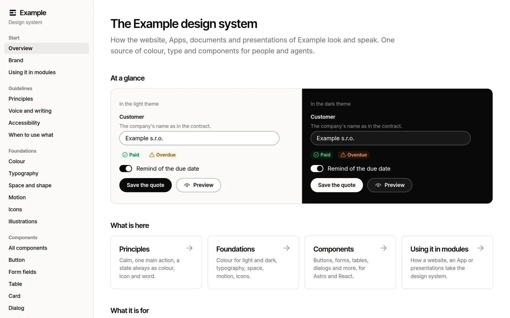

# Design system

The design system of **Example**, an invented company, in the look of
Lazurio: white and paper surfaces, hairlines, black pill buttons and one
accent. It holds the principles, the tokens for the light and the dark theme,
a library of components for Astro and React, icons, illustrations and the
self-hosted fonts, and a viewer App that shows every page in Czech and
English. An Organization replaces the brand in one place, `brand/`, and keeps
taking the template's later releases by merge.

The repository is a module that follows the
[Lazurio Module Standard](https://github.com/Lazurio/LazurioPlatform/blob/main/docs/module-standard.md).



## A template in the Marketplace of Lazurio

Another Organization takes the design system from the Marketplace of Lazurio
under "Přidat do Organizace": an agent follows [`docs/adoption.md`](docs/adoption.md),
creates a private module of that Organization and merges a release of this
repository into it, so that later releases arrive as ordinary merges. Nothing
is installed or published without the person's instruction.

- Release **2.0.0** (proposed in [`CHANGELOG.md`](CHANGELOG.md)); releases are
  annotated tags `v<semver>` with a GitHub Release.
- App generation `app/v1`: no data of its own; the content is Markdown and
  JSON in Git.
- Stack profile [`content@2026.11`](https://github.com/Lazurio/LazurioPlatform/blob/main/docs/stack-profiles.md#content):
  Bun 1.4.4, Astro 7.4.5, TypeScript 6.0.3, Biome 2.6.4, every version exact;
  React 19.3.1 at the pins of the `app` profile, only to check the React
  components.
- Screens for the Marketplace card, per language:
  [`docs/screenshots/cs/`](docs/screenshots/cs/) and [`docs/screenshots/en/`](docs/screenshots/en/).

## What is inside

| Path | Holds | Owner after adoption |
| --- | --- | --- |
| `brand/` | The brand: name, palette, fonts, radius, logo, illustrations, its own pages ([`brand/README.md`](brand/README.md)) | The Organization |
| `tokens/tokens.json` | The system tokens: colour roles for light and dark, type, space, shadow, motion, sizes; `tokens/design.md` is the prose of `DESIGN.md` | The template |
| `app/v1/kit/` | The library other modules use: `styles.css`, the tokens as CSS and TypeScript, the fonts, the components for Astro (`astro/`) and React (`react/`), the shared core (`core/`) | The template (generated parts from `brand/`) |
| `content/cs/`, `content/en/` | The pages of the viewer: principles, voice, accessibility, when to use what, foundations, every component | The template |
| `DESIGN.md` | The design system for agents, in the [DESIGN.md format](https://github.com/google-labs-code/design.md); generated | Generated |
| `app/v1/src/` | The viewer App (Astro), read-only | The template |
| `app/v1/scripts/` | `tokens.ts` (everything generated), `icons.ts` (the Iconoir icons) | The template |
| `.agents/skills/`, `.claude/` | Skills for agents: `design-system` (how to use this one) and the vendored Impeccable design skill (Apache-2.0) | The template |
| `docs/` | Adoption, extending, the Marketplace screens | The template |

Who keeps which side of a conflict when a release is merged is one rule,
stated in [`docs/extending.md`](docs/extending.md#who-owns-which-file).

## Using it in another module

A website, a knowledge base, an App or presentations take the design system
as a Git subtree of a release with a lock, and import from `app/v1/kit`:
`styles.css` once, then the components (`kit/astro/Button.astro` or
`Button` from `kit/react`). See
[Using the design system in another module](docs/adoption.md#using-the-design-system-in-another-module).

## Run the viewer

Start it through Lazurio (`lazurio module start <Organization>/design-system`)
or from Apps. The App reads its host and port only from the listener Lazurio
assigns and refuses to start without it. Opened from `main`, Lazurio builds
the viewer (`bun run build`) and serves `dist/`; the Astro development server
runs only for a preview from a worktree or `lazurio module start --dev`.

Czech is at `/`, English at `/en/`. The page follows the person's explicit
choice, then the language Lazurio gives (`/.lazurio/shell.json`), then Czech.
The theme follows the device until the person chooses light or dark.

## Develop

```sh
cd app/v1
bun install --frozen-lockfile
bun run prepare:app   # astro sync
bun run tokens        # after a change of brand/ or tokens/, or after a merge
bun run check         # types, Biome and every test, the build included
```

## Authority

When the design system disagrees with a production source of the
Organization (its website, a production UI, its brand brief), production wins
and the design system is updated. The design system is a curated mirror,
never a parallel brand silo.

## License

MIT, see [`LICENSE`](LICENSE). The brand, people and figures are fictional.
[`NOTICE`](NOTICE) says what the license covers and lists the third-party
material: the fonts (SIL Open Font License 1.1), the Iconoir icons (MIT) and
the vendored Impeccable skill (Apache-2.0).
