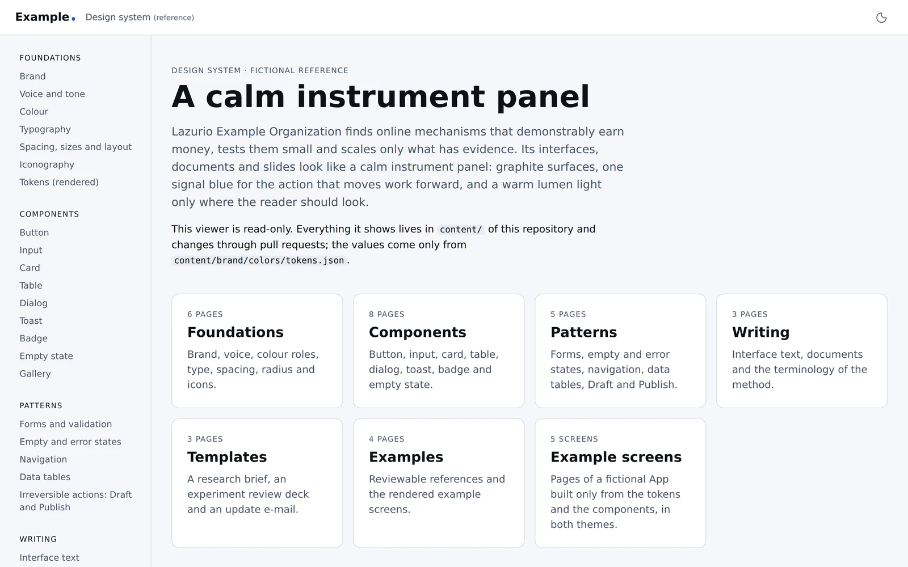

# Design system

The design system of **Lazurio Example Organization**, Lazurio's public
reference Organization. All content is fictional.

Its job is simple: neither an agent nor a colleague should invent colours,
fonts, layouts or visual rules from scratch. First the Organization's
production source of truth is found; then a curated baseline is written here
that can be repeated across the website, presentations, documents, tables,
offers and internal tools.

The repository is a module that follows the
[Lazurio Module Standard](https://github.com/Lazurio/LazurioPlatform/blob/main/docs/module-standard.md).



## Adopted from the Marketplace of Lazurio

This module is the Organization's copy of the Marketplace template
[`LazurioTemplates/design-system`](https://github.com/LazurioTemplates/design-system),
adopted at v1.0.0 (`fc64dc06b563587b215481c9d54b41f0d045aba8`) by merging the
release into this repository's own history, so that later releases arrive as
ordinary merges ([`docs/extending.md`](docs/extending.md)). The template grew
out of this design system; the Organization keeps its name, brand, repository
and port, and takes everything else from the template.

- App generation `app/v1`: no data of its own; the content is Markdown and
  tokens in Git.
- Stack profile [`content@2026.11`](https://github.com/Lazurio/LazurioPlatform/blob/main/docs/stack-profiles.md#content): Bun 1.4.4, Astro 7.4.5,
  TypeScript 6.0.3, Biome 2.6.4, every version exact.
- [`docs/extending.md`](docs/extending.md): changes within the generation,
  when the module would change generation, taking a newer release, releasing,
  and how the website, knowledge base and presentations templates build on
  the design system.
- Releases are annotated tags `v<semver>` with a GitHub Release
  ([`CHANGELOG.md`](CHANGELOG.md)).
- Screens for the Marketplace card: [`docs/screenshots/`](docs/screenshots/).

## Layout

| Path | Holds |
|---|---|
| `BASELINE.md` | The human baseline for visual and formatted work |
| `INITIALIZATION.md` | The checklist for setting up or refreshing the design system |
| `content/brand/` | **Foundations**: the brand, voice and tone, the tokens (`colors/tokens.json`), colour roles, typography, spacing and radius, iconography |
| `content/components/` | Button, input, card, table, dialog, toast, badge and empty state, each with states, usage and accessibility |
| `content/patterns/` | Forms and validation, empty and error states, navigation, data tables, irreversible actions (Draft and Publish) |
| `content/writing/` | Interface text, documents and the terminology list |
| `content/templates/` | Starters: a research brief, an experiment review deck and an update e-mail |
| `content/examples/` | Reviewable references, including the four example screens the viewer renders |
| `app/v1/` | The read-only viewer App (Astro, TypeScript) |
| `docs/` | Adoption into another Organization, extending, the Marketplace screens |
| `lazurio.module.json` | Module id, port lease and Apps |
| `LICENSE`, `NOTICE` | MIT license; what it covers and the third-party notes |

## Run the viewer

Start it through Lazurio (`lazurio module start
LazurioExampleOrganization/design-system`) or from the Launchpad. The App reads
its host and port only from the listener that Lazurio assigns and refuses to
start without it. Opened from `main`, Lazurio builds the viewer (`bun run
build`) and serves `dist/`; the Astro development server runs only for a
preview from a worktree or `lazurio module start --dev`. It only renders
`content/`; authoring happens by editing files in Git.

The viewer shows every Markdown page of `content/` at its path, the tokens of
both themes with their contrast ratios (**Tokens**), every component in its
states in both themes (**Gallery**) and the example screens of a fictional App
(**Screens**).

## Develop

```sh
cd app/v1
bun install --frozen-lockfile
bun run prepare:app   # astro sync
bun run check         # astro check, Biome and every test, the build included
bun run build         # static build only
```

## Authority

When the design system disagrees with a production source (the website, a
production UI, the brand brief in the knowledgebase or the voice guide in the
Organization root), production wins and the design system is updated. The
design system is a curated mirror, never a parallel brand silo.

## License

MIT, see [`LICENSE`](LICENSE). The brand, people and figures are fictional;
[`NOTICE`](NOTICE) says what the license covers and lists the third-party
material (none is distributed here).
